# Causal Probing of Recurrent Computation in Ouro-1.4B

**An SAE-derived loop-boundary intervention and numerical robustness study**

[](https://github.com/miheer-smk/ouro-recurrent-boundary-causal-pilot/actions/workflows/ci.yml) · [MIT software license](LICENSE) · [Citation](CITATION.cff) · [Scientific closeout](docs/scientific_closeout.md) · [Limitations](docs/limitations.md)

> [!IMPORTANT]
> **Research status: completed exploratory pilot, independently AI-reviewed.** This repository documents observed perturbation responses, **not a discovered recurrent reasoning mechanism**. The proposed FP16↔FP32 equivalence criterion **was not established**, and a DGX control batch-shape asymmetry remains an unquantified limitation. The GitHub Actions badge reflects automated code/array checks only; it does not certify scientific validity or peer review.

## At a glance

| | Frozen protocol |
|---|---|
| Model | Ouro-1.4B recurrent language model |
| Task | 30 fixed, support-conditioned SciQ questions |
| SAE-derived interventions | `seed42_feature2913`; `seed123_feature2437` |
| Reference vectors | 16 fixed matched controls per direction and question |
| Intervention | Last prompt-token post-norm state at boundary **2 or 3** |
| Continuation | **Exactly one additional recurrent iteration** |
| Readout | Correct minus fixed incorrect first-token logit margin |
| Magnitudes | Original Windows FP16 **α = 0.08** (primary), **0.16** (secondary); DGX follow-up **α = 0.08 only** |
| Follow-up computation | DGX native FP16, FP32 continuation at realized rounded endpoint, FP32 continuation at intended endpoint |
| Evidence | **12,240** DGX primary intervention margins, original Windows archive, reproducible question-level statistics |
| Scientific decision | **GO for qualified pilot closure**; not authorized as a mechanism claim or an independent replication |

## Research question

Does applying a fixed SAE-derived direction to a recurrent boundary state change Ouro-1.4B's first-token answer-margin response *differently between boundaries 2 and 3*, relative to matched random vectors? The fixed continuation horizon removes an unequal-number-of-remaining-loops confound, but the two boundary states and their surrounding recurrent contexts still differ.

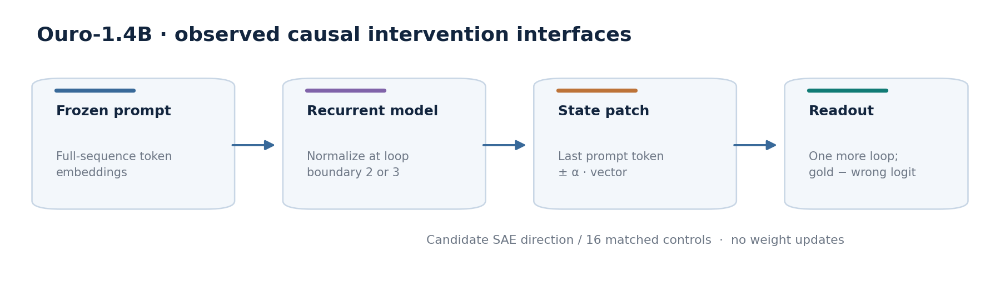

*Figure 1. Experiment-level architecture diagram. Shows the **observed intervention and readout interfaces**—not a claimed algorithmic mechanism or complete implementation-level model architecture. [Editable Mermaid source](figures/source/architecture.mmd); [SVG](figures/rendered/00_architecture.svg).*

### Source-verified recurrent model schematic

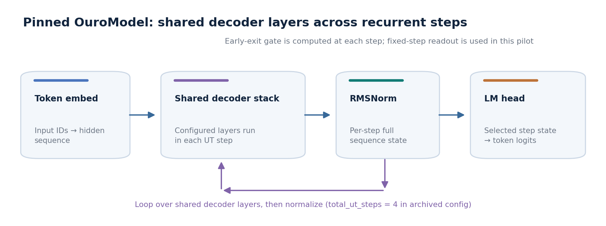

*Pinned OuroModel source (SHA-256 `c5c68fbb…`): token embeddings enter a decoder-layer stack whose modules are reused across recurrent iterations, followed by RMSNorm after each iteration. A per-step early-exit gate is computed, while this experiment reads logits from a specified step through the LM head. This is an implementation-grounded schematic, not a claim about discovered algorithmic circuits. [Editable Mermaid](figures/source/ouro_core_schematic.mmd) · [SVG](figures/rendered/00_model_core_schematic.svg).*

<details>
<summary><strong>Editable architecture flowchart (Mermaid)</strong></summary>

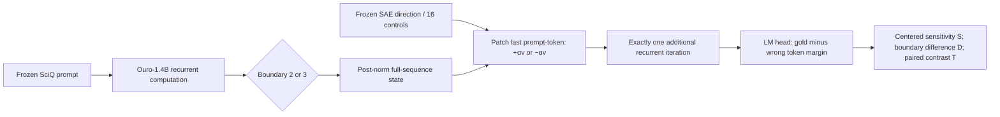

</details>

## Causal estimand

Let `m(+αv, b)` and `m(−αv, b)` denote the correct-minus-fixed-incorrect first-continuation-token logit margins after patching the final prompt-token state at boundary `b` and running exactly one additional recurrent pass:

$$
S(v,b,\alpha)=\frac{m(+\alpha v,b)-m(-\alpha v,b)}{2\alpha},
\qquad D(v,\alpha)=S(v,3,\alpha)-S(v,2,\alpha).
$$

For frozen question `q` and direction `j` with 16 matched controls `cₖ(q,j)`:

$$
P_{qj}(\alpha)=D(v_j,\alpha)-\frac{1}{16}\sum_{k=1}^{16}D(c_k(q,j),\alpha),
\qquad T_j(\alpha)=\frac{1}{30}\sum_{q=1}^{30}P_{qj}(\alpha).
$$

A negative `T` means the direction's *boundary-3-minus-boundary-2 finite-amplitude response* is more negative than the mean matched-control response. It is **not** evidence that the direction improves question-answering accuracy, mediates reasoning, or represents a known semantic concept. See [methodology](docs/scientific_closeout.md) and [architecture notes](docs/architecture.md).

## Principal results

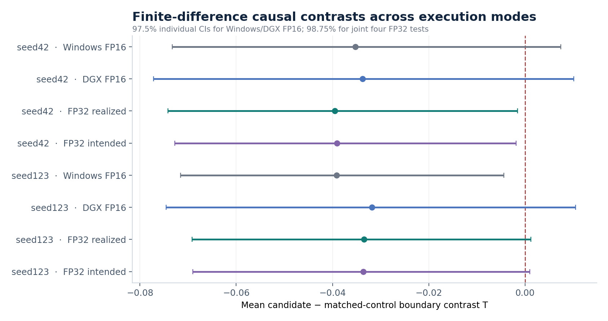

*Figure 2. Mean paired effect `T` with question-bootstrap intervals. FP16 modes use 97.5% individual coverage for the **two-direction** family within mode. FP32 modes use 98.75% individual coverage for the **joint four-test** family (two directions × two FP32 modes). These are not independent confirmations. [SVG](figures/rendered/01_effect_forest.svg).*

| SAE direction | Windows FP16 primary | DGX FP16 | DGX FP32 realized | DGX FP32 intended |
|---|---:|---:|---:|---:|
| `seed42_feature2913` | −0.035219 | −0.033716 | −0.039519 | −0.039061 |
| `seed123_feature2437` | −0.039126 | −0.031783 | −0.033467 | −0.033604 |

All eight mean effect estimates are negative. **This descriptive agreement is not numerical equivalence.** Within each FP32 mode, both directions exclude zero using a separate two-direction adjustment; when all four FP32 tests are treated as one family, **only seed42** excludes zero. The original Windows FP16 primary supported seed123 under its original two-direction procedure; this is not a successful independent replication.

## Numerical robustness: equivalence not established

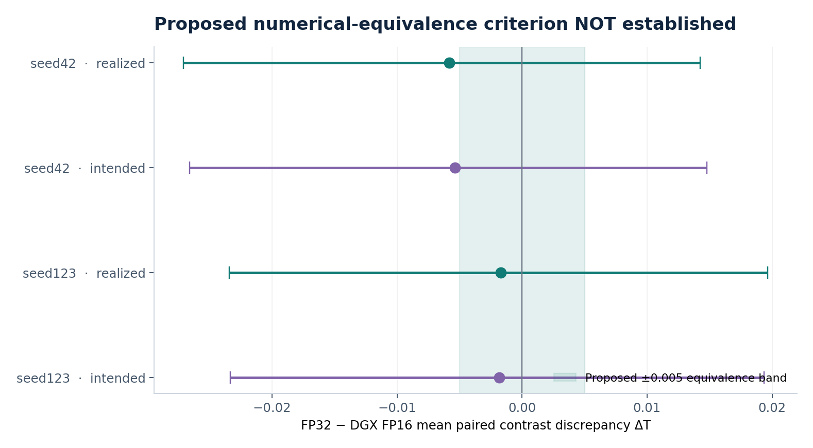

*Figure 3. FP32−DGX-FP16 paired-mean discrepancy with 95% bootstrap intervals and a **post-pilot, Astra-proposed** equivalence region of ±0.005 `T` units. **None of the four intervals is wholly inside the band**. Failure to establish equivalence does not establish a nonzero population difference. [SVG](figures/rendered/03_precision_equivalence.svg).*

| Direction | FP32 arithmetic | Mean ΔT | Paired 95% CI | Question-level RMS | Sign flips |
|---|---|---:|---|---:|---:|
| seed42 | Realized | −0.005804 | [−0.027076, +0.014249] | 0.057542 | 9 / 30 |
| seed42 | Intended | −0.005345 | [−0.026580, +0.014792] | 0.057690 | 9 / 30 |
| seed123 | Realized | −0.001684 | [−0.023426, +0.019664] | 0.060725 | 9 / 30 |
| seed123 | Intended | −0.001821 | [−0.023310, +0.019345] | 0.060240 | 8 / 30 |

The FP32 continuation begins from **DGX FP16-generated full-sequence boundary states**, using parameters first loaded in FP16 then upcast. The study does not include an end-to-end FP32 trajectory from original full-precision weights.

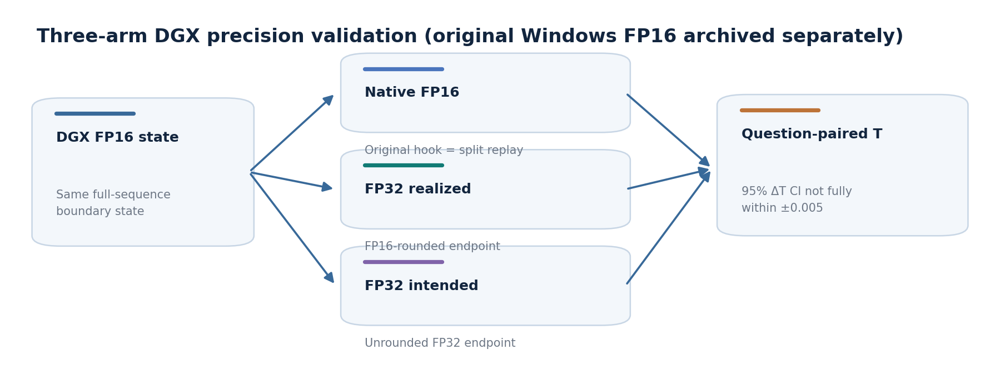

*Figure 4. Precision-validation flow, including separate realized and intended intervention endpoints. [Mermaid source](figures/source/validation_pipeline.mmd); [SVG](figures/rendered/00_validation_pipeline.svg).*

## Results gallery

| Question-level effects | Endpoint rounding |
|---|---|
| 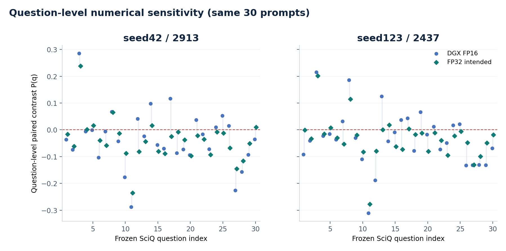 | 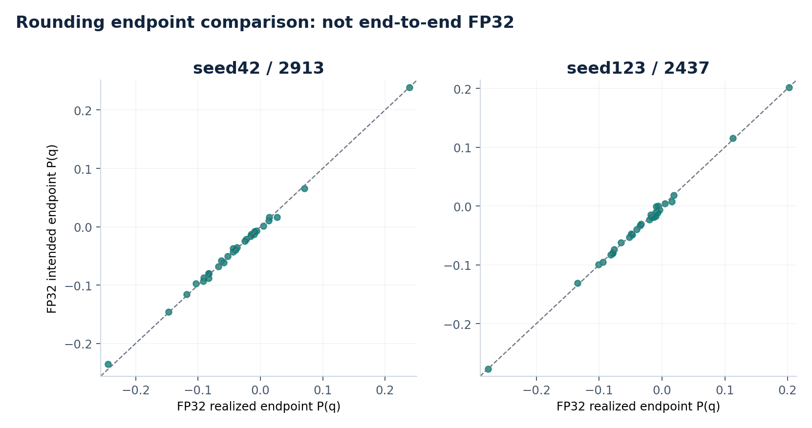 |
| Same 30 prompts reused in each mode; individual question effects can change substantially. | FP32 intended and realized effects are close on average; not a full quantization decomposition. |
| Original magnitude sensitivity | Cross-hardware FP16 sensitivity |
| 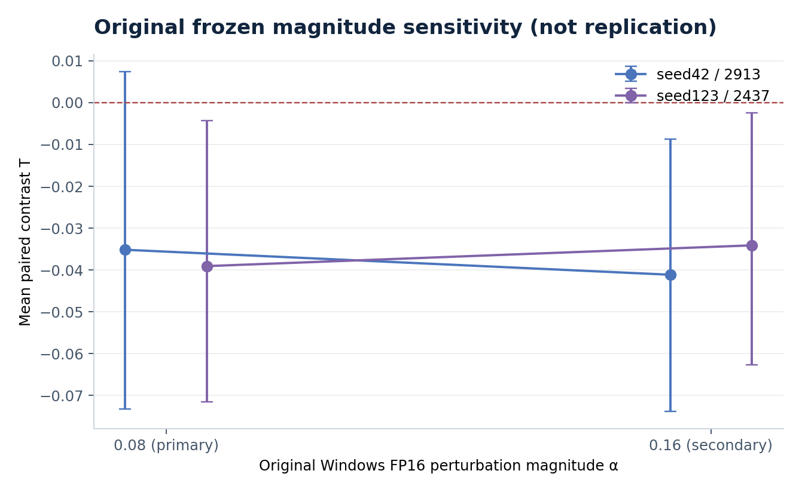 | 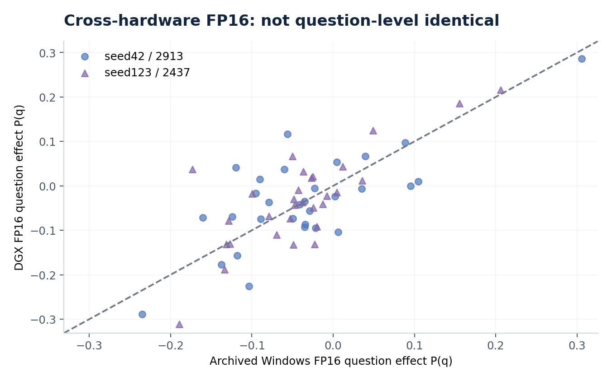 |
| **α=0.08 vs 0.16 on Windows FP16 only**; not independent confirmation. | Mean agreement does not imply question-level FP16 equality across GPU implementations. |

### Batch-shape limitation identified during independent review

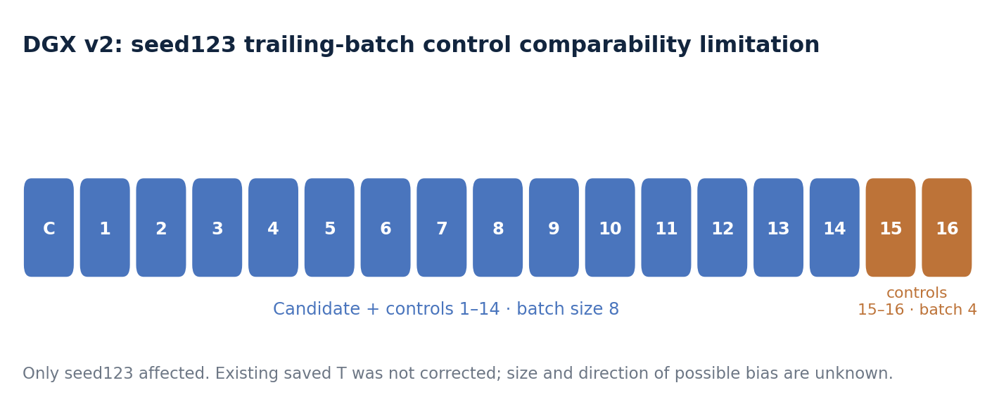

*Figure 5. In DGX v2, two seed123 controls were executed in a trailing **batch of four**, while the candidate and fourteen other controls used **batch of eight**. A separate diagnostic showed FP16 baseline states are batch-shape-sensitive. The consequent bias in the reported `T` remains **unknown**; raw results have not been retrospectively corrected.*

This limitation is not known to explain the analogous seed42 contrast, whose DGX v2 candidate and controls used batch size eight. More details: [sensitivity matrix](docs/sensitivity_matrix.md), [negative findings](docs/limitations.md), [independent AI-assisted assessment](review/ASTRA_AI_ASSISTED_REVIEW.md).

## Reproduce the numerical audit (CPU-only)

The repository includes **exact archived original and DGX numerical NPZ arrays**, SHA-256 commitments, a modular NumPy analysis package, and source-controlled figure generation. It **does not** include model weights, SciQ text, SAE checkpoints, matched-control tensor files, or the full original GPU inference environment.

```bash
python -m venv .venv
# Activate the environment (Windows: .venv\Scripts\activate; Linux/macOS: source .venv/bin/activate)
python -m pip install -e '.[test]'
python scripts/verify_artifacts.py
pytest -q
python scripts/reproduce_statistics.py --output results/derived/reproduced.json
python scripts/generate_figures.py
```

The analysis reconstructs sensitivity, boundary differences and candidate−control paired contrasts directly from saved margins, then performs **20,000 question-paired bootstrap draws**, seed `20261030`. Unit tests verify immutable array hashes, ordering, exact reconstruction, expected means, and failure to meet the equivalence criterion. See [reproducibility details](docs/reproducibility.md).

## Research artifact structure

```text
src/ouro_boundary_pilot/   Immutable-artifact loaders, statistics, plotting
scripts/                   CPU provenance verification, reanalysis, figure regeneration
tests/                     Exact reconstruction and invariant tests
results/raw/               Archived numerical margins (Windows FP16 + DGX)
results/reports/           Original and DGX research summaries
figures/source/            Editable Mermaid diagrams
figures/rendered/          Reproducible PNG + SVG diagrams and plots
docs/                      Scientific report, architecture, reproducibility, limitations
review/                    Astra's independent AI-assisted scientific review
historical/                Original DGX v2 execution source (requires external dependencies)
.github/workflows/         CI for CPU reanalysis, not full-model inference
```

## Scope, provenance, and research ethics

- **Original scientific inference:** Frozen Windows FP16 pilot. **Post-pilot:** DGX precision validation, independent reconstruction, and Astra review. They share questions and directions.
- **Adversarial review:** Astra recommended **Recommendation A — close the study as a qualified exploratory pilot**. The review is independent AI-assisted analysis, **not journal peer review**. Its original audit bundle omitted several execution dependencies; their SHA-256 commitments remain in the local verified evidence archive.
- **Licensing:** Original authored code, prose and figures are released under [MIT](LICENSE), subject to authorship rights. Third-party model code, checkpoints and SciQ data have their own terms and are intentionally excluded. See [third-party notices](THIRD_PARTY_NOTICES.md).
- **Scientific limits:** No semantic identification of either SAE direction, no identified reasoning algorithm, no mechanistic necessity, no independent held-out replication, and no numerical-equivalence certification. See [full limitations](docs/limitations.md).

**Author:** Miheer Kulkarni · Indian Institute of Information Technology (IIIT) Nagpur. [Citation metadata](CITATION.cff). Original scientific closeout date: 2026-10-28.
